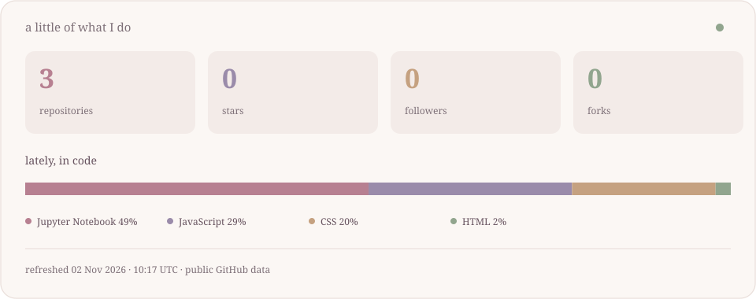

  

computer science student · web development · learning MLOps

Hi, I'm Ananta. I like making things for the web and figuring out how they work behind the scenes. Most of this space is projects, lab work, and things I'm still learning.

 

### a few things I've worked on

[**mentHer ↗**](https://github.com/AnantaUpadhyay/mentHer_project)  
A project with Harshita and Sanjana, bringing mentorship and resources for women entrepreneurs into one place. Built with React, Express, and MySQL.

[**MLOps lab ↗**](https://github.com/AnantaUpadhyay/Mlops-Lab)  
My practical work for MLOps. Still learning, still adding to it.

 

  

### things I reach for

`Python` · `JavaScript` · `React` · `Node.js` · `Express` · `MySQL` · `Git`

 

  

a note on the numbers

Updated daily from public GitHub data. Repository count includes this profile. Stars, forks, and language bytes exclude forks and this profile repository. Language percentages describe files, not proficiency.

 

thanks for stopping by ♡

walking cat adapted from <a href="https://github.com/AsleepX/homepage-cat">AsleepX/homepage-cat</a> · <a href="assets/CAT-LICENSE.txt">MIT</a>

