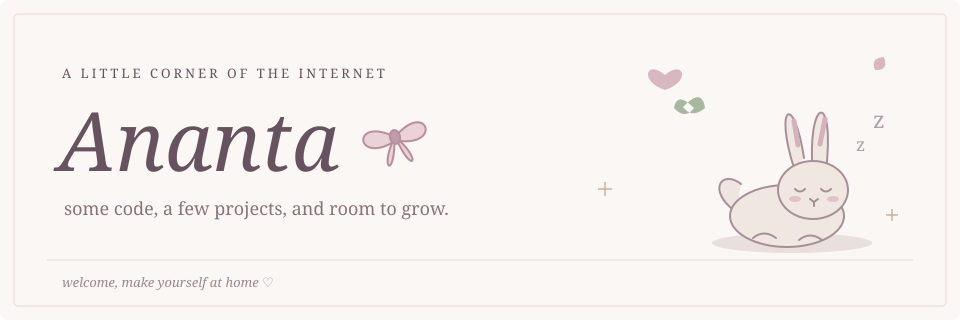

  

computer science student · web development · learning MLOps

Hi, I'm Ananta. I like making things for the web and figuring out how they work behind the scenes. I'm working through MLOps practicals alongside a team project called mentHer. This is where I keep the work as I go.

 

### a few things I've worked on

[**mentHer ↗**](https://github.com/AnantaUpadhyay/mentHer_project)  
A project with Harshita and Sanjana, bringing mentorship and resources for women entrepreneurs into one place. Built with React, Express, and MySQL.

peek at the database design

[**MLOps lab ↗**](https://github.com/AnantaUpadhyay/Mlops-Lab)  
My practical work for MLOps. Still learning, still adding to it.

 

  

### things I reach for

`Python` · `JavaScript` · `React` · `Node.js` · `Express` · `MySQL` · `Git`

 

### a little progress, day by day

  <picture>
    <source media="(prefers-color-scheme: dark)" srcset="assets/snake-dark.svg" />
    <source media="(prefers-color-scheme: light)" srcset="assets/snake.svg" />
    
  </picture>

one square, one day · my GitHub contributions from the past year · refreshed daily

stats, if you're curious

  

The snake follows GitHub's contribution calendar, which includes qualifying commits, pull requests, issues, and reviews—not just commits. It is a daily snapshot, not a live feed.

Stats update daily from public GitHub data. Repository count includes this profile. Stars, forks, and language bytes exclude forks and this profile repository. Language percentages describe files, not proficiency.

 

thanks for stopping by ♡

walking cat adapted from <a href="https://github.com/AsleepX/homepage-cat">AsleepX/homepage-cat</a> · <a href="assets/CAT-LICENSE.txt">MIT</a> · contribution snake by <a href="https://github.com/Platane/snk">Platane/snk</a>

